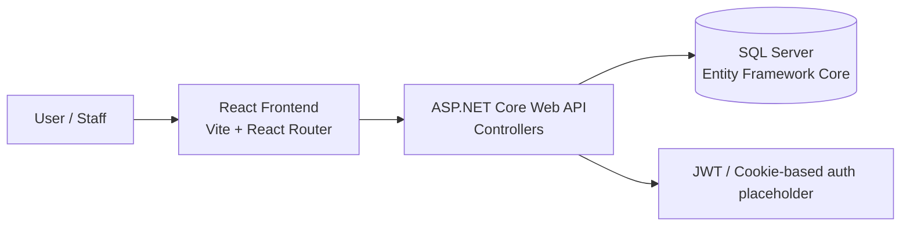
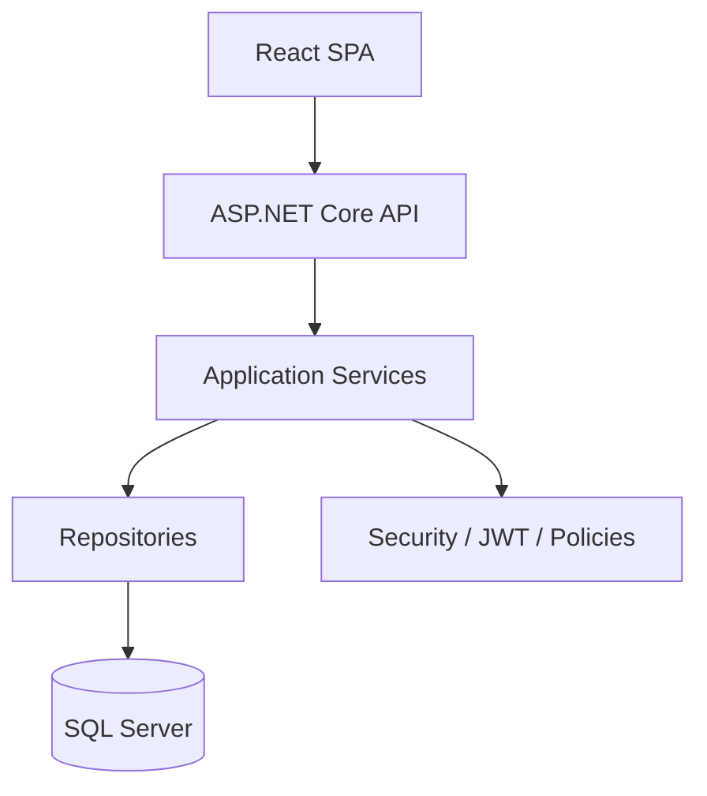

# School Management System - Architecture Document

## 1. Purpose and scope
This solution is a school administration application for managing core academic and operational records. It includes a React single-page frontend and an ASP.NET Core backend connected to SQL Server through Entity Framework Core. The current implementation focuses on authentication, teacher management, student management screens, exam-related pages, billing, and events/holidays.

## 2. High-level architecture
The system follows a client-server architecture with clear separation between the presentation layer and the data access layer.

- Frontend: React 19 + Vite + Redux Toolkit + React Router
- Backend: ASP.NET Core Web API on .NET 8
- Persistence: SQL Server via Entity Framework Core
- Communication: HTTP JSON requests from React app to API endpoints

## 3. Layered view of the solution
### 3.1 Presentation layer
The frontend is responsible for route-based navigation and feature screens. The root application in [Frontend/src/App.jsx](../Frontend/src/App.jsx) wires the routing structure and Redux provider. Main UI areas include:

- Login and Signup
- Dashboard
- Teacher management
- Student management
- Billing
- Exam results
- Events and holidays

The sidebar in [Frontend/src/Components/Sidebar/Sidebar.jsx](../Frontend/src/Components/Sidebar/Sidebar.jsx) organizes navigation into major modules, while the layout shell in [Frontend/src/Components/MainPage/Mainpage.jsx](../Frontend/src/Components/MainPage/Mainpage.jsx) provides the main application frame.

### 3.2 Application layer
The backend exposes REST-style controllers in the [Backend/Backend/Controllers](../Backend/Backend/Controllers) folder.

- AuthenticationController handles registration and login
- TeacherController handles teacher add/search/update actions
- StudentController is scaffolded but currently under development
- UserController contains additional user-oriented operations and delete/search logic

This layer contains business logic and field validation checks for operations such as duplicate teacher emails and update detection.

### 3.3 Data layer
The data access layer is centered on [Backend/Backend/Data/AppDbContext.cs](../Backend/Backend/Data/AppDbContext.cs), which contains the EF Core DbSets for:

- Users
- Teachers
- Students

The database connection is configured in [Backend/Backend/appsettings.json](../Backend/Backend/appsettings.json).

## 4. Runtime behavior
### 4.1 Authentication flow
The authentication flow is implemented through a login and registration endpoint:

- POST /api/authentication/login
- POST /api/authentication/register

The backend uses ASP.NET Core Identity PasswordHasher to hash passwords, then issues a JWT token and stores it in an HTTP-only cookie. The implementation exists in [Backend/Backend/Controllers/AuthenticationController.cs](../Backend/Backend/Controllers/AuthenticationController.cs).

### 4.2 Teacher management flow
Teacher data is managed through the TeacherController and helper APIs exposed by the frontend service layer in [Frontend/src/Server.js](../Frontend/src/Server.js).

Operations include:

- Add teacher
- Update teacher
- Search teachers by name
- Delete teacher entry

The service layer uses Axios to call the backend base URL configured to localhost 5183. In the current implementation, form data is posted for add/update operations.

### 4.3 Student and overall admin flow
The student module is present in the frontend navigation and model definitions, but the student controller and associated API flows are only partially implemented. The Student model exists in [Backend/Backend/Models/Student.cs](../Backend/Backend/Models/Student.cs), and its UI pages are present under [Frontend/src/Components/StudentComponents](../Frontend/src/Components/StudentComponents).

## 5. Key design patterns in the current implementation
### 5.1 Feature-oriented frontend structure
The React UI is organized by feature folder, which is a practical and maintainable pattern for a school management system:

- Components/
  - Login
  - Signup
  - Dashboard
  - Sidebar
  - Teacher
  - StudentComponents
  - Billing
  - Exams
  - EventsOrHolidays

### 5.2 Controller-based backend API
The API uses explicit controller classes rather than a full service/repository abstraction. This is simple and fast for a learning project, but it makes the application less scalable as business rules grow.

### 5.3 Cross-cutting concerns
The backend includes a custom filter and middleware layer:

- [Backend/Backend/Filters/CustomFilter1.cs](../Backend/Backend/Filters/CustomFilter1.cs)
- [Backend/Backend/Middlewares/UserExistMiddleware.cs](../Backend/Backend/Middlewares/UserExistMiddleware.cs)

These are intended to enforce application-level checks and request interception, but the filter implementation is currently incomplete and the middleware contains placeholder logic rather than production-ready behavior.

## 6. Technical stack summary
### Backend
- ASP.NET Core Web API (.NET 8)
- Entity Framework Core
- SQL Server LocalDB
- ASP.NET Core Identity PasswordHasher
- JWT generation using System.IdentityModel.Tokens.Jwt

### Frontend
- React 19
- Vite
- React Router
- Redux Toolkit
- Axios
- Tailwind CSS

## 7. Architectural strengths
- Clear separation between frontend and backend
- Feature-oriented UI organization
- EF Core-based persistence with a relational schema
- Modular navigation for school admin tasks
- Use of Redux for cross-component teacher state management

## 8. Architectural gaps and risks
The solution is promising but still contains several engineering risks that should be addressed before production use:

1. Incomplete backend security setup
   - JWT configuration is referenced but not defined in configuration files.
   - Middleware logic is placeholder-based and does not enforce real-user checks.
   - Cookies are made secure but the application is likely not using HTTPS in development.

2. Incomplete domain implementation
   - StudentController is empty.
   - UserController contains commented-out student logic.
   - The API is not fully implemented for all screens.

3. Data integrity issues
   - Some operations use First() without checking whether a record exists, which can throw exceptions.
   - Update logic sometimes removes and re-adds records instead of updating values directly.
   - Some model properties are strings for numeric values like Salary and TotalFee, which reduces type safety.

4. Weak architecture layering
   - Controllers currently contain business logic directly, without dedicated services or repositories.
   - There is no clear validation layer, unit-of-work abstraction, or repository pattern.

## 9. Recommended target architecture
For a production-ready version, the system should evolve toward a more structured layered architecture:

Recommended improvements:

- Introduce services and repositories for Teacher, Student, Billing, Exams, and Auth
- Add centralized validation and exception handling
- Add role-based authorization and route protection
- Expand Student, Billing, and Exam models to fully support the use cases
- Add automated testing and integration tests

## 10. Conclusion
The current solution demonstrates a workable school management application scaffold with a strong feature-oriented structure. It is best understood as an early-stage but promising application architecture that combines a modern React frontend with a .NET API and SQL-backed persistence model. The biggest next step is to convert the current prototype into a robust layered architecture with stronger security, data quality, and business logic boundaries.
